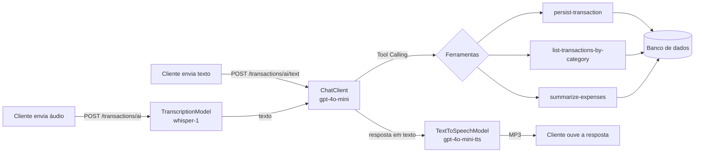

# Assistente financeiro por voz com Spring Boot e Spring AI

API de orçamento que entende **comandos de voz**: você envia um áudio como *"ontem gastei 80 reais no mercado"*, a IA entende o pedido, executa uma função real da aplicação (registrar ou consultar gastos) e responde **em áudio**. Também dá para conversar com o assistente **por texto**.

Projeto desenvolvido no desafio final da trilha Spring Boot da [DIO](https://www.dio.me/), a partir do módulo [`05-spring-ai`](https://github.com/digitalinnovationone/dio-spring-boot-learning-track/tree/main/05-spring-ai) do repositório [dio-spring-boot-learning-track](https://github.com/digitalinnovationone/dio-spring-boot-learning-track).

## Sumário

- [O que o projeto faz](#o-que-o-projeto-faz)
- [Melhorias implementadas](#melhorias-implementadas)
- [Tecnologias](#tecnologias)
- [Como executar](#como-executar)
- [Endpoints](#endpoints)
- [Como testar o fluxo principal](#como-testar-o-fluxo-principal)
- [Testes automatizados](#testes-automatizados)
- [Estrutura do projeto](#estrutura-do-projeto)
- [O que aprendi](#o-que-aprendi)
- [Próximos passos](#próximos-passos)

## O que o projeto faz



1. O cliente envia um arquivo de áudio.
2. O `TranscriptionModel` transforma o áudio em texto.
3. O `ChatClient` envia o texto para o modelo de linguagem junto com as **ferramentas** disponíveis e a data de hoje.
4. O modelo decide qual ferramenta usar e o Spring AI executa o método Java correspondente (um caso de uso real da aplicação).
5. O caso de uso grava ou consulta transações no banco.
6. O modelo escreve a resposta final, e o `TextToSpeechModel` a converte em MP3.

No endpoint de texto (`/transactions/ai/text`), os passos 2 e 6 ficam de fora: o texto entra direto e a resposta volta em JSON.

A IA **não acessa o banco diretamente**: ela só pode chamar os casos de uso expostos com `@Tool`. As mesmas regras de negócio valem para a API REST e para a IA.

## Melhorias implementadas

Fiz as melhorias em duas etapas, sem quebrar a arquitetura em camadas do projeto original.

### Etapa 1: assistente mais confiável e com uma consulta nova

#### 1. Correção de bug: valores em centavos apareciam como reais

O valor de uma transação é guardado em **centavos** (`8050` = R$ 80,50), mas a conversão para a resposta não dividia por 100:

```java
// Antes: 8050 centavos virava 8050.0
BigDecimal.valueOf(transaction.getAmount()).setScale(2, RoundingMode.HALF_UP).doubleValue();

// Depois: 8050 centavos vira 80.5
BigDecimal.valueOf(cents, 2).doubleValue();
```

Isso afetava a API REST **e a IA**, porque a ferramenta devolvia `8050.0` para o modelo, que podia responder "oito mil e cinquenta reais". A conversão agora fica em um só lugar ([`Cents`](src/main/java/dio/budgeting/application/output/Cents.java)), e os testes falham se o comportamento antigo voltar.

#### 2. Nova consulta financeira: resumo de gastos (nova ferramenta de Tool Calling)

Novo caso de uso [`SummarizeExpensesUseCase`](src/main/java/dio/budgeting/application/SummarizeExpensesUseCase.java), exposto de duas formas:

- **Para a IA**, como a ferramenta `summarize-expenses`. Dá para perguntar *"quanto eu gastei?"* ou *"onde estou gastando mais?"*.
- **Na API REST**, como `GET /transactions/summary`.

Ele retorna o total geral, a quantidade de transações e o total por categoria (da maior para a menor). As somas são feitas em centavos (`long`) e convertidas para reais só no final, para evitar erros de arredondamento com `double`.

#### 3. Validações antes de salvar uma transação

As regras ficam no **domínio** ([`Transaction`](src/main/java/dio/budgeting/domain/Transaction.java)), então valem para qualquer entrada: descrição obrigatória (até 255 caracteres), valor maior que zero, categoria obrigatória e, desde a etapa 2, data obrigatória e que não esteja no futuro.

- **API REST:** responde `400 Bad Request` no formato padrão [Problem Details (RFC 9457)](https://www.rfc-editor.org/rfc/rfc9457), via [`ApiExceptionHandler`](src/main/java/dio/budgeting/infrastructure/http/ApiExceptionHandler.java).
- **IA:** o Spring AI devolve a mensagem do erro para o modelo (`spring.ai.tools.throw-exception-on-error=false`, o padrão), e o assistente explica o problema para a pessoa em vez de gravar um dado inválido.
- **Áudio vazio:** o `POST /transactions/ai` responde `400` antes de chamar a OpenAI, sem gastar créditos à toa.

#### 4. Respostas da IA pensadas para voz

O [prompt de sistema](src/main/resources/prompts/system-message.st) foi reescrito porque a resposta vira áudio: respostas curtas, sem markdown ou emojis, valores e datas falados de forma natural ("80 reais e 50 centavos", "ontem"), categorias em português e a orientação de pedir para repetir quando faltar informação, em vez de inventar um valor.

#### 5. Testes que rodam sem chave da OpenAI e sem Docker

No projeto original, `./gradlew test` falhava porque os testes não tinham banco de dados (o MySQL do Docker Compose não sobe durante os testes). Agora os testes rodam com H2 em memória e com os modelos de IA simulados (mocks). Veja [Testes automatizados](#testes-automatizados).

#### 6. Ajustes menores

- **Perfil `local`** com banco H2 em arquivo, para rodar sem Docker/MySQL.
- **Limite de upload de 25 MB**, o mesmo da API de transcrição da OpenAI. O padrão do Spring é 1 MB, o que barrava áudios maiores.
- O prompt de sistema passou a ser lido sempre em UTF-8, independente do sistema operacional.

### Etapa 2: quatro melhorias de uso

#### 7. Mensagens de erro claras

Antes, um valor errado na URL mostrava a "Whitelabel Error Page", e um JSON com categoria inexistente devolvia só `{"status":400,"error":"Bad Request"}`, sem dizer o que estava errado. Quando a OpenAI recusava a chamada (chave inválida ou conta sem créditos), a API respondia um erro 500 genérico.

Agora o [`ApiExceptionHandler`](src/main/java/dio/budgeting/infrastructure/http/ApiExceptionHandler.java) explica cada caso. Respostas reais da aplicação (resumidas aos campos `title` e `detail`):

```text
GET /transactions/GROCERIES.        (com um ponto no final)
400 {"title":"Parâmetro inválido","detail":"Valor inválido para 'category': 'GROCERIES.'. Use um destes: GROCERIES, PHARMA, AUTO, RESTAURANT, OTHER."}

POST /transactions  {"category":"MERCADO", ...}
400 {"title":"Requisição inválida","detail":"Valor inválido para 'category': 'MERCADO'. Use um destes: GROCERIES, PHARMA, AUTO, RESTAURANT, OTHER."}

GET /transactions/summary?from=ontem
400 {"title":"Parâmetro inválido","detail":"Valor inválido para 'from': 'ontem'. Use uma data no formato AAAA-MM-DD."}

POST /transactions/ai/text          (conta da OpenAI sem créditos)
502 {"title":"Falha no serviço de IA","detail":"A conta da OpenAI está sem créditos. Adicione créditos em platform.openai.com e tente de novo."}

POST /transactions/ai               (chave inválida)
502 {"title":"Falha no serviço de IA","detail":"A chave do serviço de IA foi recusada. Confira a variável OPENAI_API_KEY (ou GROQ_API_KEY, no perfil groq)."}
```

Também há uma mensagem para o limite de uso atingido (comum no plano gratuito da Groq).

A lista de categorias da mensagem vem do próprio enum, então se atualiza sozinha. Na transcrição de áudio, o erro da OpenAI vem embrulhado em outra exceção; por isso o handler procura o motivo em toda a cadeia de causas, e registra o erro original no log.

#### 8. Novas categorias: restaurante e outros

O enum [`Category`](src/main/java/dio/budgeting/domain/Category.java) ganhou `RESTAURANT` (restaurante, lanchonete, delivery) e `OTHER` (outros). O prompt explica as categorias para a IA e pede para usar `OTHER` só quando nenhuma outra servir.

O ponto difícil não estava no Java, e sim no banco. Investigando o banco do perfil `local` (H2), descobri que o Hibernate tinha criado a coluna `category` como um **ENUM do banco** com só os 3 valores antigos. Testei duas alternativas (`@JdbcTypeCode(SqlTypes.VARCHAR)` e um `AttributeConverter`), e nas duas o Hibernate ainda criava uma restrição `CHECK` com a lista de categorias. Como o `ddl-auto=update` não altera colunas nem restrições que já existem, gravar `RESTAURANT` ia falhar.

A solução foi guardar a categoria como texto comum na entidade JPA ([`TransactionEntity`](src/main/java/dio/budgeting/infrastructure/persistence/entity/TransactionEntity.java)) e converter para o enum só ao montar o objeto de domínio. Assim a coluna fica `VARCHAR` sem restrição, e **uma categoria nova no futuro só exige mudar o enum**.

> **Bancos criados com a versão anterior** precisam de um ajuste, uma única vez:
>
> - MySQL: `ALTER TABLE transaction_entity MODIFY category VARCHAR(255);`
> - H2 do perfil `local`: `ALTER TABLE TRANSACTION_ENTITY ALTER COLUMN CATEGORY SET DATA TYPE VARCHAR(255);` (ou apague a pasta `data/` para começar do zero)

#### 9. Endpoint de texto para conversar com a IA

Novo endpoint `POST /transactions/ai/text`, que recebe `{"message": "..."}` e devolve `{"answer": "..."}`. Ele usa o mesmo assistente (prompt, ferramentas e regras) do endpoint de áudio, mas sem a transcrição e sem a geração de voz.

Isso deixa os testes do assistente mais baratos e rápidos, e permite usá-lo em um chat. No [`TransactionController`](src/main/java/dio/budgeting/infrastructure/http/TransactionController.java), os dois endpoints chamam o mesmo método `ask()`.

A única diferença é o formato da resposta, porque um texto lido e um áudio ouvido pedem coisas diferentes:

| Endpoint | Exemplo de valor na resposta | Regras |
| --- | --- | --- |
| `/transactions/ai/text` | "R$45 (quarenta e cinco reais)" | [`answer-rules-text.st`](src/main/resources/prompts/answer-rules-text.st) |
| `/transactions/ai` (voz) | "quarenta e cinco reais" | [`answer-rules-voice.st`](src/main/resources/prompts/answer-rules-voice.st) |

Na voz, o "R$45" seria lido em voz alta e o valor apareceria duas vezes. As regras de cada canal entram no prompt de sistema pelo parâmetro `{answerRules}`.

#### 10. Data nos gastos e consultas por período

Cada gasto agora tem uma **data**:

- Na API REST, o campo `date` (`AAAA-MM-DD`) é opcional; sem ele, vale a data de hoje.
- Por voz ou texto, a IA entende *"ontem"* ou *"na segunda"*. Como o modelo **não sabe que dia é hoje**, a data atual vai no prompt de sistema a cada pedido (`Hoje é {weekday}, {today}`).
- O domínio recusa datas no futuro.

O resumo aceita um **período** (`from` e `to`, ambos opcionais e inclusivos). Isso permite perguntar *"quanto gastei este mês?"* ou *"quanto gastei em setembro?"*, e na API REST: `GET /transactions/summary?from=2026-10-01&to=2026-10-31`. A regra do período fica no domínio, no record [`Period`](src/main/java/dio/budgeting/domain/Period.java), que também recusa um período com a data inicial depois da final.

Um teste de contrato pegou um problema do **Spring AI 2.0.0-M4**: quando um parâmetro de ferramenta é um `LocalDate` solto, a data `2025-10-01` é lida como JSON sem aspas, e a chamada falha. Dentro de um record funciona, então as datas do resumo foram para o [`SummarizeExpensesInput`](src/main/java/dio/budgeting/application/input/SummarizeExpensesInput.java), no mesmo padrão que o projeto já usava em `PersistTransactionInput`.

> Gastos gravados antes desta versão ficam sem data: aparecem no resumo geral, mas não nos resumos por período.

## Tecnologias

| Tecnologia | Uso |
| --- | --- |
| Java 25 | Linguagem |
| Spring Boot 4.0.5 | Web (REST), Data JPA, Docker Compose |
| Spring AI 2.0.0-M4 | `ChatClient`, Tool Calling, transcrição e geração de voz |
| OpenAI | `gpt-4o-mini` (chat), `whisper-1` (transcrição), `gpt-4o-mini-tts` (voz) |
| Groq (opcional, perfil `groq`) | `openai/gpt-oss-120b` (chat), `whisper-large-v3-turbo` (transcrição), no plano gratuito |
| MySQL 9 (Docker Compose) | Banco de dados no desenvolvimento |
| H2 | Banco do perfil `local` e dos testes |
| JUnit 5, AssertJ, Mockito, MockMvc | Testes |
| Gradle 9 (wrapper) e Lombok | Build |

## Como executar

### Pré-requisitos

- **JDK 25**
- **Chave da API da OpenAI com créditos**, só para o fluxo com IA (o CRUD REST funciona com qualquer valor na variável). Para testar a IA de graça, veja a [opção C](#opção-c-testar-a-ia-de-graça-com-a-groq)
- **Docker** (opcional): sem ele, use o perfil `local`

O Gradle Wrapper baixa o Gradle sozinho, não precisa instalar.

### Opção A: com Docker (MySQL)

O Spring Boot sobe o MySQL do [`compose.yml`](compose.yml) automaticamente.

```bash
export OPENAI_API_KEY="sua_chave_aqui"
./gradlew bootRun
```

### Opção B: sem Docker (perfil `local` com H2)

Os dados ficam salvos em `./data/budgeting.mv.db`.

```bash
export OPENAI_API_KEY="sua_chave_aqui"
./gradlew bootRun --args='--spring.profiles.active=local'
```

No **Windows (PowerShell)**:

```powershell
$env:OPENAI_API_KEY="sua_chave_aqui"
.\gradlew.bat bootRun --args='--spring.profiles.active=local'
```

A aplicação sobe em `http://localhost:8080`.

> Nunca coloque a chave da OpenAI no código ou em arquivos do repositório. Use a variável de ambiente.

### Opção C: testar a IA de graça com a Groq

A API da OpenAI não tem uso gratuito: as chamadas exigem créditos pré-pagos. Para testar a IA sem pagar, o projeto tem o perfil `groq`. A [Groq](https://console.groq.com) tem um plano gratuito (com limite de uso) e uma API compatível com a da OpenAI, então basta mudar o endereço e a chave, sem mudar o código. O arquivo [`application-groq.properties`](src/main/resources/application-groq.properties) faz isso:

| Parte | Com o perfil `groq` |
| --- | --- |
| Chat com Tool Calling | Groq, modelo `openai/gpt-oss-120b` (dá para trocar com a variável `GROQ_CHAT_MODEL`) |
| Transcrição do áudio | Groq, modelo `whisper-large-v3-turbo` |
| Resposta em áudio (voz) | Continua na OpenAI: a Groq não tem voz em português |

> A Groq desativa modelos com frequência: o `llama-3.3-70b-versatile`, por exemplo, saiu do plano gratuito em 16/08/2026. Se aparecer o erro "O modelo de IA configurado não existe", escolha outro em [console.groq.com/docs/models](https://console.groq.com/docs/models) e defina `$env:GROQ_CHAT_MODEL`. O plano gratuito também limita os tokens por minuto; se aparecer "O limite de uso do serviço de IA foi atingido", espere um minuto.

Ou seja, com uma chave gratuita da Groq dá para usar o `POST /transactions/ai/text` e rodar os testes de integração com a IA. O `POST /transactions/ai` transcreve e executa o comando, mas só devolve o MP3 com créditos na OpenAI.

Crie uma chave em [console.groq.com/keys](https://console.groq.com/keys) e rode:

```powershell
$env:GROQ_API_KEY="sua_chave_groq"
.\gradlew.bat bootRun --args='--spring.profiles.active=local,groq'
```

Para rodar os testes de integração com a IA usando a Groq:

```powershell
$env:GROQ_API_KEY="sua_chave_groq"
$env:SPRING_PROFILES_ACTIVE="groq"
.\gradlew.bat test
```

## Endpoints

| Método | Caminho | O que faz |
| --- | --- | --- |
| `POST` | `/transactions` | Registra um gasto. `amount` em **centavos**; `date` opcional (`AAAA-MM-DD`, padrão: hoje). |
| `GET` | `/transactions/{category}` | Lista os gastos de uma categoria: `GROCERIES`, `PHARMA`, `AUTO`, `RESTAURANT` ou `OTHER`. |
| `GET` | `/transactions/summary` | Total geral e por categoria. Período opcional: `?from=AAAA-MM-DD&to=AAAA-MM-DD`. |
| `POST` | `/transactions/ai/text` | **Novo.** Conversa com o assistente por texto: recebe `{"message": "..."}` e devolve `{"answer": "..."}`. |
| `POST` | `/transactions/ai` | Recebe um áudio (`multipart/form-data`, campo `file`) e devolve a resposta em MP3. |

> Na requisição, `amount` é em centavos (`8050`). Nas respostas, os valores são em reais (`80.5`).
>
> Erros: `400` para dados inválidos e `502` quando a OpenAI recusa a chamada. Os dois vêm com a explicação no campo `detail`.

O arquivo [`requests.http`](requests.http) tem todas as requisições prontas para usar no IntelliJ ou na extensão REST Client do VS Code.

## Como testar o fluxo principal

### 1. Com a IA (precisa de `OPENAI_API_KEY` com créditos)

**Por texto**, o jeito mais barato de testar o assistente:

```bash
curl -X POST http://localhost:8080/transactions/ai/text \
  -H "Content-Type: application/json" \
  -d '{"message":"Ontem gastei 45 reais e 90 centavos num restaurante"}'
```

**Por voz**, com as gravações de exemplo de [`src/test/resources/audio`](src/test/resources/audio). A `recording-1.m4a` contém um gasto de 80 reais:

```bash
curl -X POST http://localhost:8080/transactions/ai \
  -F "file=@src/test/resources/audio/recording-1.m4a" \
  --output resposta.mp3
```

Abra o `resposta.mp3` para ouvir a confirmação. Frases para testar, por texto ou em áudios gravados por você (m4a, mp3, wav, webm...):

| Frase | O que deve acontecer |
| --- | --- |
| *"Gastei 45 reais na farmácia"* | Registra com `persist-transaction`, data de hoje |
| *"Ontem jantei fora e gastei 120 reais"* | Registra em `RESTAURANT` com a data de ontem |
| *"Quais foram meus gastos no mercado?"* | Consulta com `list-transactions-by-category` |
| *"Quanto eu gastei este mês?"* | `summarize-expenses` com o período do mês atual |
| *"Gastei zero reais no posto"* | Nada é registrado e o assistente explica o motivo |

Depois, confira no banco o que a IA gravou: `curl http://localhost:8080/transactions/summary`.

### 2. API REST (funciona sem chave da OpenAI)

Respostas reais obtidas rodando a aplicação com o perfil `local`, em 20/10/2026:

```text
$ curl -X POST http://localhost:8080/transactions -H "Content-Type: application/json" \
    -d '{"description":"Pizza com a familia","category":"RESTAURANT","amount":8990,"date":"2026-10-19"}'
{"id":"99427912-c51d-4a0e-854b-d403359ddab2","category":"RESTAURANT","description":"Pizza com a familia","amount":89.9,"date":"2026-10-19"}   [HTTP 201]

$ curl -X POST http://localhost:8080/transactions -H "Content-Type: application/json" \
    -d '{"description":"Cinema","category":"OTHER","amount":4000,"date":"2099-01-01"}'
{"detail":"A data do gasto não pode estar no futuro.","instance":"/transactions","status":400,"title":"Transação inválida"}   [HTTP 400]

$ curl "http://localhost:8080/transactions/summary?from=2026-09-01&to=2026-09-30"
{"from":"2026-09-01","to":"2026-09-30","categories":[{"category":"GROCERIES","transactionCount":1,"total":200.0}],"transactionCount":1,"total":200.0}   [HTTP 200]

$ curl "http://localhost:8080/transactions/summary?from=2026-10-31&to=2026-10-01"
{"detail":"A data inicial não pode ser depois da data final.","instance":"/transactions/summary","status":400,"title":"Período inválido"}   [HTTP 400]
```

#### No Windows (PowerShell)

Os exemplos com `curl` acima são para Bash (Linux, macOS ou Git Bash). No Windows PowerShell eles não funcionam como estão: lá o `curl` é um apelido do `Invoke-WebRequest`, e o `curl.exe` recebe o JSON sem as aspas, o que faz a API responder `400`. Use o `Invoke-RestMethod`, com `charset=utf-8` para os acentos chegarem certos:

```powershell
Invoke-RestMethod -Method Post -Uri http://localhost:8080/transactions `
  -ContentType 'application/json; charset=utf-8' `
  -Body '{"description":"Remédio","category":"PHARMA","amount":3990}'

Invoke-RestMethod "http://localhost:8080/transactions/summary?from=2026-10-01" | ConvertTo-Json -Depth 3

Invoke-RestMethod -Method Post -Uri http://localhost:8080/transactions/ai/text `
  -ContentType 'application/json; charset=utf-8' `
  -Body '{"message":"Quanto eu gastei este mês?"}'
```

O Windows PowerShell 5.1 pode exibir `Remédio` na resposta. É só a exibição: a API responde em UTF-8 e o dado é salvo certo. Abrindo `http://localhost:8080/transactions/PHARMA` no navegador, aparece `Remédio`.

Para o comando de voz, o `curl.exe` funciona normalmente, porque envia um arquivo e não JSON:

```powershell
curl.exe -X POST http://localhost:8080/transactions/ai -F "file=@src/test/resources/audio/recording-1.m4a" --output resposta.mp3
```

## Testes automatizados

```bash
./gradlew test
```

Sem chave de IA: **48 testes passando**. Os 8 testes de integração que chamam a IA de verdade são pulados quando não há chave. `AssistantFlowIT` e `OpenAiTranscriptionModelIT` também rodam com uma chave gratuita da Groq ([opção C](#opção-c-testar-a-ia-de-graça-com-a-groq)); os outros 4 testam recursos específicos da OpenAI.

| Classe de teste | O que verifica |
| --- | --- |
| [`TransactionTest`](src/test/java/dio/budgeting/domain/TransactionTest.java) | Regras de validação do domínio, incluindo a data |
| [`PeriodTest`](src/test/java/dio/budgeting/domain/PeriodTest.java) | Período com pontas inclusivas, pontas abertas e período invertido |
| [`PersistTransactionUseCaseTest`](src/test/java/dio/budgeting/application/PersistTransactionUseCaseTest.java) | Centavos para reais, data padrão (hoje) e que nada inválido é salvo |
| [`SummarizeExpensesUseCaseTest`](src/test/java/dio/budgeting/application/SummarizeExpensesUseCaseTest.java) | Totais por categoria, ordenação, filtro por período e resumo vazio |
| [`ToolCallingContractTest`](src/test/java/dio/budgeting/application/ToolCallingContractTest.java) | Chama as ferramentas **como o modelo faz** (pelo nome, com argumentos JSON), confere o esquema que o modelo recebe (datas opcionais e as 5 categorias) e que os erros voltam como mensagem para a IA |
| [`TransactionControllerTest`](src/test/java/dio/budgeting/infrastructure/http/TransactionControllerTest.java) | Endpoints REST com H2, mensagens de erro, período, endpoints de IA com os modelos simulados: texto enviado ao modelo, data de hoje no prompt, as 3 ferramentas registradas, MP3 devolvido e erros da OpenAI (sem créditos e chave inválida) |
| [`BudgetingApplicationTests`](src/test/java/dio/budgeting/BudgetingApplicationTests.java) | O contexto do Spring sobe |
| [`AssistantFlowIT`](src/test/java/dio/budgeting/AssistantFlowIT.java) | **Com a IA real:** "ontem gastei 45,90 num restaurante" grava `4590` centavos em `RESTAURANT` com a data de ontem; "quanto gastei este mês?" ignora o mês passado; "gastei zero reais" não grava nada |
| `OpenAi*IT` e `ToolCallingIT` | Testes originais do projeto, que chamam a OpenAI diretamente |

Os testes com a IA real conferem **o que foi gravado no banco**, e não o texto exato da resposta, que muda a cada chamada. Para rodá-los, defina `OPENAI_API_KEY` (de uma conta com créditos) ou use a Groq ([opção C](#opção-c-testar-a-ia-de-graça-com-a-groq)) antes do `./gradlew test`.

Para conferir que os testes protegem a correção do item 1, coloquei a conversão antiga de volta temporariamente: **6 testes falharam**. Com a correção, todos passam.

## Estrutura do projeto

```text
src/main/java/dio/budgeting
├── domain                                      # Modelo e regras de negócio
│   ├── Transaction.java                        # validações, incluindo a data
│   ├── Category.java                           # + RESTAURANT e OTHER
│   ├── Period.java                             # período de datas (novo)
│   ├── InvalidTransactionException.java
│   ├── InvalidPeriodException.java             # (novo)
│   └── TransactionRepository.java
├── application                                 # Casos de uso, usados pela API REST e pela IA
│   ├── PersistTransactionUseCase.java          # @Tool persist-transaction
│   ├── ListTransactionsByCategoryUseCase.java  # @Tool list-transactions-by-category
│   ├── SummarizeExpensesUseCase.java           # @Tool summarize-expenses
│   ├── input
│   │   ├── PersistTransactionInput.java        # + date opcional
│   │   └── SummarizeExpensesInput.java         # período (novo)
│   └── output
│       ├── Cents.java                          # conversão centavos → reais
│       ├── ExpensesSummaryOutput.java
│       └── TransactionOutput.java
└── infrastructure
    ├── http
    │   ├── TransactionController.java          # REST, /ai e /ai/text (novo)
    │   ├── ApiExceptionHandler.java            # erros 400 e 502 com explicação
    │   ├── request/                            # TransactionRequest, AssistantRequest
    │   └── response/                           # TransactionResponse, ExpensesSummaryResponse, AssistantResponse
    └── persistence
        ├── entity/TransactionEntity.java       # categoria como texto, coluna transaction_date
        └── repository/                         # adaptadores JPA

src/main/resources
├── application.properties                      # limite de upload
├── application-local.properties                # perfil sem Docker
└── prompts
    ├── system-message.st                       # prompt do assistente, com a data de hoje
    ├── answer-rules-text.st                    # formato da resposta em texto: "R$45 (quarenta e cinco reais)"
    └── answer-rules-voice.st                   # formato da resposta falada: "quarenta e cinco reais"
```

## O que aprendi

- **Tool Calling é o que liga a IA à aplicação.** O modelo não executa código. Ele escolhe uma ferramenta e o Spring AI chama o método Java. Por isso, o nome e a descrição do `@Tool` e dos `@ToolParam` importam tanto quanto o código: é com eles que o modelo decide o que fazer.
- **Regras de negócio devem ficar no domínio.** Com a validação em `Transaction` e em `Period`, a mesma regra protege a API REST e a IA, e o erro vira uma explicação falada em vez de um dado errado no banco.
- **Detalhes de unidade fazem diferença.** O bug dos centavos mostra como um erro pequeno de conversão chega até a resposta que a pessoa ouve.
- **O prompt depende do canal.** Uma resposta boa para ler na tela (com listas e símbolos) fica ruim quando vira áudio.
- **O modelo não sabe que dia é hoje.** Para entender "ontem" ou "este mês", a data atual precisa ir no prompt a cada pedido.
- **Dá para testar IA sem gastar com a API.** Simular os modelos (`@MockitoBean`) e chamar as ferramentas com JSON testa a integração de forma rápida e repetível. Foi um teste desses que encontrou o problema do `LocalDate` no Spring AI.
- **O `ddl-auto=update` não evolui o banco.** Ele cria tabelas e colunas novas, mas não altera as existentes. Por isso uma categoria nova quebraria bancos antigos; em um projeto real, o certo é usar migrações versionadas (Flyway ou Liquibase).
- **Spring Boot 4 mudou alguns pacotes de teste:** `@MockitoBean` no lugar de `@MockBean`, o starter `spring-boot-starter-webmvc-test` e o `AutoConfigureMockMvc` em um pacote novo.

## Próximos passos

- Usar **Flyway** para versionar as mudanças no banco, em vez do `ddl-auto=update`.
- **Editar ou excluir um gasto** por voz, com confirmação antes de apagar.
- Aceitar **período** também na listagem por categoria (*"quanto gastei no mercado este mês?"*).
- Padronizar o nome do valor: `amount` em centavos na entrada e em reais na saída pode confundir.

## Créditos

Projeto base: módulo `05-spring-ai` do repositório [digitalinnovationone/dio-spring-boot-learning-track](https://github.com/digitalinnovationone/dio-spring-boot-learning-track), usado no desafio da DIO.
