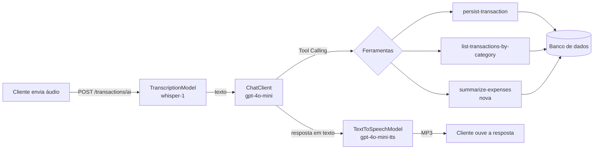

# Assistente financeiro por voz com Spring Boot e Spring AI

API de orçamento que entende **comandos de voz**: você envia um áudio como *"gastei 80 reais no mercado"*, a IA entende o pedido, executa uma função real da aplicação (registrar ou consultar gastos) e responde **em áudio**.

Projeto desenvolvido no desafio final da trilha Spring Boot da [DIO](https://www.dio.me/), a partir do módulo [`05-spring-ai`](https://github.com/digitalinnovationone/dio-spring-boot-learning-track/tree/main/05-spring-ai) do repositório [dio-spring-boot-learning-track](https://github.com/digitalinnovationone/dio-spring-boot-learning-track).

## Sumário

- [O que o projeto faz](#o-que-o-projeto-faz)
- [Melhorias implementadas](#melhorias-implementadas)
- [Tecnologias](#tecnologias)
- [Como executar](#como-executar)
- [Endpoints](#endpoints)
- [Como testar o fluxo principal](#como-testar-o-fluxo-principal)
- [Testes automatizados](#testes-automatizados)
- [Estrutura do projeto](#estrutura-do-projeto)
- [O que aprendi](#o-que-aprendi)
- [Próximos passos](#próximos-passos)

## O que o projeto faz



1. O cliente envia um arquivo de áudio.
2. O `TranscriptionModel` transforma o áudio em texto.
3. O `ChatClient` envia o texto para o modelo de linguagem junto com as **ferramentas** disponíveis.
4. O modelo decide qual ferramenta usar e o Spring AI executa o método Java correspondente (um caso de uso real da aplicação).
5. O caso de uso grava ou consulta transações no banco.
6. O modelo escreve a resposta final, e o `TextToSpeechModel` a converte em MP3.

A IA **não acessa o banco diretamente**: ela só pode chamar os casos de uso expostos com `@Tool`. As mesmas regras de negócio valem para a API REST e para a IA.

## Melhorias implementadas

Tema escolhido: **deixar o assistente mais confiável e com uma consulta nova**, sem quebrar a arquitetura em camadas do projeto original.

### 1. Correção de bug: valores em centavos apareciam como reais

O valor de uma transação é guardado em **centavos** (`8050` = R$ 80,50), mas a conversão para a resposta não dividia por 100:

```java
// Antes: 8050 centavos virava 8050.0
BigDecimal.valueOf(transaction.getAmount()).setScale(2, RoundingMode.HALF_UP).doubleValue();

// Depois: 8050 centavos vira 80.5
BigDecimal.valueOf(cents, 2).doubleValue();
```

Isso afetava a API REST **e a IA**, porque a ferramenta devolvia `8050.0` para o modelo, que podia responder "oito mil e cinquenta reais". A conversão agora fica em um só lugar ([`Cents`](src/main/java/dio/budgeting/application/output/Cents.java)), e os testes falham se o comportamento antigo voltar.

### 2. Nova consulta financeira: resumo de gastos (nova ferramenta de Tool Calling)

Novo caso de uso [`SummarizeExpensesUseCase`](src/main/java/dio/budgeting/application/SummarizeExpensesUseCase.java), exposto de duas formas:

- **Para a IA**, como a ferramenta `summarize-expenses`. Agora dá para perguntar por voz *"quanto eu gastei?"* ou *"onde estou gastando mais?"*.
- **Na API REST**, como `GET /transactions/summary`.

Ele retorna o total geral, a quantidade de transações e o total por categoria (da maior para a menor). As somas são feitas em centavos (`long`) e convertidas para reais só no final, para evitar erros de arredondamento com `double`.

### 3. Validações antes de salvar uma transação

As regras ficam no **domínio** ([`Transaction`](src/main/java/dio/budgeting/domain/Transaction.java)), então valem para qualquer entrada:

- a descrição é obrigatória e tem no máximo 255 caracteres (o tamanho da coluna no banco);
- o valor precisa ser maior que zero;
- a categoria é obrigatória.

Cada canal trata o erro do seu jeito:

- **API REST:** responde `400 Bad Request` no formato padrão [Problem Details (RFC 9457)](https://www.rfc-editor.org/rfc/rfc9457), via [`ApiExceptionHandler`](src/main/java/dio/budgeting/infrastructure/http/ApiExceptionHandler.java).
- **IA:** o Spring AI devolve a mensagem do erro para o modelo (`spring.ai.tools.throw-exception-on-error=false`, o padrão), e o assistente explica o problema para a pessoa em vez de gravar um dado inválido.
- **Áudio vazio:** o `POST /transactions/ai` responde `400` antes de chamar a OpenAI, sem gastar créditos à toa.

### 4. Respostas da IA pensadas para voz

O [prompt de sistema](src/main/resources/prompts/system-message.st) foi reescrito porque a resposta vira áudio:

- respostas curtas, sem markdown, listas ou emojis (que soariam estranhos na fala);
- valores falados de forma natural ("80 reais e 50 centavos", e não "80.5");
- categorias em português (GROCERIES → mercado);
- quando usar cada ferramenta, e que a entrada é em centavos;
- se faltar informação, pedir para repetir em vez de inventar um valor.

### 5. Testes que rodam sem chave da OpenAI e sem Docker

No projeto original, `./gradlew test` falhava porque os testes não tinham banco de dados (o MySQL do Docker Compose não sobe durante os testes). Agora há **22 testes** que rodam com H2 em memória e com os modelos de IA simulados (mocks). Veja [Testes automatizados](#testes-automatizados).

### 6. Ajustes menores

- **Perfil `local`** com banco H2 em arquivo, para rodar sem Docker/MySQL.
- **Limite de upload de 25 MB**, o mesmo da API de transcrição da OpenAI. O padrão do Spring é 1 MB, o que barrava áudios maiores.
- O prompt de sistema passou a ser lido sempre em UTF-8, independente do sistema operacional.

## Tecnologias

| Tecnologia | Uso |
| --- | --- |
| Java 25 | Linguagem |
| Spring Boot 4.0.5 | Web (REST), Data JPA, Docker Compose |
| Spring AI 2.0.0-M4 | `ChatClient`, Tool Calling, transcrição e geração de voz |
| OpenAI | `gpt-4o-mini` (chat), `whisper-1` (transcrição), `gpt-4o-mini-tts` (voz) |
| MySQL 9 (Docker Compose) | Banco de dados no desenvolvimento |
| H2 | Banco do perfil `local` e dos testes |
| JUnit 5, AssertJ, Mockito, MockMvc | Testes |
| Gradle 9 (wrapper) e Lombok | Build |

## Como executar

### Pré-requisitos

- **JDK 25**
- **Chave da API da OpenAI**, só para o fluxo com IA (o CRUD REST funciona com qualquer valor na variável)
- **Docker** (opcional): sem ele, use o perfil `local`

O Gradle Wrapper baixa o Gradle sozinho, não precisa instalar.

### Opção A: com Docker (MySQL)

O Spring Boot sobe o MySQL do [`compose.yml`](compose.yml) automaticamente.

```bash
export OPENAI_API_KEY="sua_chave_aqui"
./gradlew bootRun
```

### Opção B: sem Docker (perfil `local` com H2)

Os dados ficam salvos em `./data/budgeting.mv.db`.

```bash
export OPENAI_API_KEY="sua_chave_aqui"
./gradlew bootRun --args='--spring.profiles.active=local'
```

No **Windows (PowerShell)**:

```powershell
$env:OPENAI_API_KEY="sua_chave_aqui"
.\gradlew.bat bootRun --args='--spring.profiles.active=local'
```

A aplicação sobe em `http://localhost:8080`.

## Endpoints

| Método | Caminho | O que faz |
| --- | --- | --- |
| `POST` | `/transactions` | Registra um gasto. O campo `amount` da requisição é em **centavos**. |
| `GET` | `/transactions/{category}` | Lista os gastos de uma categoria: `GROCERIES`, `PHARMA` ou `AUTO`. |
| `GET` | `/transactions/summary` | **Novo.** Total geral e total por categoria. |
| `POST` | `/transactions/ai` | Recebe um áudio (`multipart/form-data`, campo `file`) e devolve a resposta em MP3. |

> Na requisição, `amount` é em centavos (`8050`). Nas respostas, os valores são em reais (`80.5`).

O arquivo [`requests.http`](requests.http) tem todas as requisições prontas para usar no IntelliJ ou na extensão REST Client do VS Code.

## Como testar o fluxo principal

### 1. Comando de voz (precisa de `OPENAI_API_KEY` válida)

O projeto já traz gravações de exemplo em [`src/test/resources/audio`](src/test/resources/audio). A `recording-1.m4a`, por exemplo, contém um gasto de 80 reais.

```bash
curl -X POST http://localhost:8080/transactions/ai \
  -F "file=@src/test/resources/audio/recording-1.m4a" \
  --output resposta.mp3
```

Abra o `resposta.mp3` para ouvir a confirmação. Depois, consulte o que foi gravado:

```bash
curl http://localhost:8080/transactions/summary
```

Você também pode gravar seus próprios áudios (m4a, mp3, wav, webm...) com frases como:

- *"Gastei 45 reais na farmácia"*: registra um gasto com `persist-transaction`
- *"Quais foram meus gastos no mercado?"*: consulta com `list-transactions-by-category`
- *"Quanto eu gastei até agora?"*: usa a nova ferramenta `summarize-expenses`
- *"Gastei zero reais no posto"*: nada é registrado e o assistente explica o motivo (pela regra do prompt ou pela validação do domínio)

### 2. API REST (funciona sem chave da OpenAI)

Respostas reais obtidas rodando a aplicação com o perfil `local`:

```text
$ curl -X POST http://localhost:8080/transactions -H "Content-Type: application/json" \
    -d '{"description":"Compras no mercado","category":"GROCERIES","amount":8050}'
{"id":"e73c4336-34b0-4fdc-acd6-139ede262f32","category":"GROCERIES","description":"Compras no mercado","amount":80.5}   [HTTP 201]

$ curl -X POST http://localhost:8080/transactions -H "Content-Type: application/json" \
    -d '{"description":"Compras no mercado","category":"GROCERIES","amount":0}'
{"detail":"O valor do gasto deve ser maior que zero.","instance":"/transactions","status":400,"title":"Transação inválida"}   [HTTP 400]

# (depois de registrar também gasolina, feira e farmácia)
$ curl http://localhost:8080/transactions/summary
{"categories":[{"category":"AUTO","transactionCount":1,"total":200.0},{"category":"GROCERIES","transactionCount":2,"total":121.0},{"category":"PHARMA","transactionCount":1,"total":39.9}],"transactionCount":4,"total":360.9}   [HTTP 200]
```

> **Dica para Windows:** no PowerShell, use `curl.exe` (o `curl` sozinho é um apelido do `Invoke-WebRequest`). Se o JSON tiver acentos, o terminal pode enviar o texto em outra codificação e a API responde `400`. Nesse caso, salve o JSON em um arquivo UTF-8 e envie com `--data-binary @arquivo.json`, ou use o [`requests.http`](requests.http).

## Testes automatizados

```bash
./gradlew test
```

Resultado: **22 testes passando**. Os 5 testes de integração originais, que chamam a OpenAI de verdade, são pulados quando `OPENAI_API_KEY` não está definida.

| Classe de teste | O que verifica |
| --- | --- |
| [`TransactionTest`](src/test/java/dio/budgeting/domain/TransactionTest.java) | Regras de validação do domínio |
| [`PersistTransactionUseCaseTest`](src/test/java/dio/budgeting/application/PersistTransactionUseCaseTest.java) | Conversão de centavos para reais e que nada inválido é salvo |
| [`SummarizeExpensesUseCaseTest`](src/test/java/dio/budgeting/application/SummarizeExpensesUseCaseTest.java) | Totais por categoria, ordenação e resumo vazio |
| [`ToolCallingContractTest`](src/test/java/dio/budgeting/application/ToolCallingContractTest.java) | Chama as ferramentas **como o modelo faz** (pelo nome, com argumentos JSON) e confere que o erro de validação volta como mensagem para a IA |
| [`TransactionControllerTest`](src/test/java/dio/budgeting/infrastructure/http/TransactionControllerTest.java) | Endpoints REST com H2 e o fluxo `/transactions/ai` com transcrição, chat e voz simulados: confere o texto enviado ao modelo, o prompt de sistema, as 3 ferramentas registradas e o MP3 devolvido |
| [`BudgetingApplicationTests`](src/test/java/dio/budgeting/BudgetingApplicationTests.java) | O contexto do Spring sobe |

Para conferir que os testes protegem a correção do item 1, coloquei a conversão antiga de volta temporariamente: **6 testes falharam**. Com a correção, todos passam.

Para rodar também os testes de integração com a OpenAI (eles consomem créditos), defina `OPENAI_API_KEY` antes do `./gradlew test`. Eles agora usam o H2 de testes para subir o contexto.

## Estrutura do projeto

```text
src/main/java/dio/budgeting
├── domain                                  # Modelo e regras de negócio
│   ├── Transaction.java                    # (alterado) validações
│   ├── InvalidTransactionException.java    # (novo)
│   └── TransactionRepository.java          # (alterado) findAll()
├── application                             # Casos de uso, usados pela API REST e pela IA
│   ├── PersistTransactionUseCase.java      # @Tool persist-transaction
│   ├── ListTransactionsByCategoryUseCase.java  # @Tool list-transactions-by-category
│   ├── SummarizeExpensesUseCase.java       # (novo) @Tool summarize-expenses
│   └── output
│       ├── Cents.java                      # (novo) conversão centavos → reais
│       ├── ExpensesSummaryOutput.java      # (novo)
│       └── TransactionOutput.java          # (alterado) correção do bug
└── infrastructure
    ├── http
    │   ├── TransactionController.java      # (alterado) /summary, nova tool, validação do áudio
    │   ├── ApiExceptionHandler.java        # (novo) erros 400 em Problem Details
    │   └── response/ExpensesSummaryResponse.java  # (novo)
    └── persistence                         # Adaptadores JPA

src/main/resources
├── application.properties                  # (alterado) limite de upload
├── application-local.properties            # (novo) perfil sem Docker
└── prompts/system-message.st               # (alterado) prompt pensado para voz
```

## O que aprendi

- **Tool Calling é o que liga a IA à aplicação.** O modelo não executa código. Ele escolhe uma ferramenta e o Spring AI chama o método Java. Por isso, o nome e a descrição do `@Tool` e dos `@ToolParam` importam tanto quanto o código: é com eles que o modelo decide o que fazer.
- **Regras de negócio devem ficar no domínio.** Com a validação em `Transaction`, a mesma regra protege a API REST e a IA, e o erro vira uma explicação falada em vez de um dado errado no banco.
- **Detalhes de unidade fazem diferença.** O bug dos centavos mostra como um erro pequeno de conversão chega até a resposta que a pessoa ouve.
- **O prompt depende do canal.** Uma resposta boa para ler na tela (com listas e símbolos) fica ruim quando vira áudio.
- **Dá para testar IA sem gastar com a API.** Simular os modelos (`@MockitoBean`) e chamar as ferramentas com JSON testa a integração de forma rápida e repetível.
- **Spring Boot 4 mudou alguns pacotes de teste:** `@MockitoBean` no lugar de `@MockBean`, o starter `spring-boot-starter-webmvc-test` e o `AutoConfigureMockMvc` em um pacote novo.

## Próximos passos

- Guardar a **data** de cada transação, para responder *"quanto gastei este mês?"*.
- Criar **mais categorias** (restaurante, lazer, outros). Antes, é preciso verificar como a coluna `category` foi criada no MySQL, porque o `ddl-auto=update` não altera colunas que já existem.
- Um endpoint que receba **texto** em vez de áudio, para testar a IA sem gravar.
- Padronizar o nome do valor: `amount` em centavos na entrada e em reais na saída pode confundir.

## Créditos

Projeto base: módulo `05-spring-ai` do repositório [digitalinnovationone/dio-spring-boot-learning-track](https://github.com/digitalinnovationone/dio-spring-boot-learning-track), usado no desafio da DIO.
